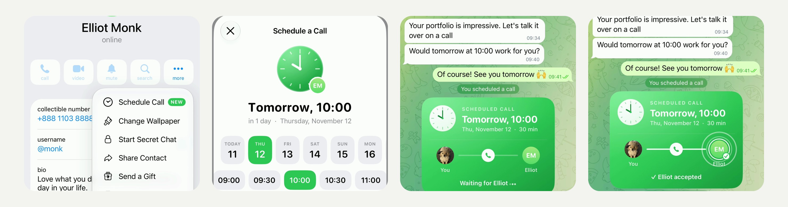

# Schedule Call - plan a call from a profile, accepted right in the chat (iOS)

Open someone's profile, tap **…** and pick the new **Schedule Call**: choose the day, the time and how long, and a green
card lands in your chat with them, centered like a service message. They accept it with one tap, and the card shows it
on both sides; when the time comes, the card turns into a Call button.

[](Media/schedule-call.mp4)

▶︎ [Media/schedule-call.mp4](Media/schedule-call.mp4) - the feature in the iOS Simulator (2160×2160, 60 fps, 25 s, loops).

Pure UIKit and Telegram's own components (the glass sheet and buttons, the context menu, avatars), no new dependencies,
no server changes. 24 files, +3571 −1: four new modules, a new file in the chat controller, and hooks in
10 existing files. Builds with the project's own `Make.py build` (`debug_sim_arm64`).

## How it works

- **The menu item.** In the **…** menu of a person's profile (not a bot, not yourself, someone you can call and have not
  blocked), Schedule Call comes first. The first three times it is seen it introduces itself: the row lights up green
  and grows a little as it fills, the clock pops up with its hands sweeping round twice, the title rises letter by
  letter and a NEW badge springs out with a sheen.
- **The form.** Schedule a Call comes in part by part: the title letter by letter, a green clock with the other
  person's face on it, the date, then the days, the times, the length and the button, each sliding and unblurring in
  turn. It opens on the next whole hour after the next one (or tomorrow at 10:00). Picking a day or a time slides the
  green selection under it, turns the clock's hands to the new time and rolls the date letter by letter ("Today, 11:00"
  → "Tomorrow, 10:00"), with "in 1 day · Thursday, November 12" under it. Times that have passed are greyed out; a day
  with none left cannot be picked; at midnight the days move on.
- **Sending.** Schedule Call closes the form, goes back to the chat with that person and sends the call. Its card opens
  out of its clock in a growing circle: the hands sweep to the time, "Tomorrow, 10:00" comes in letter by letter, the two
  faces come in from the middle with the line and the phone between them, a sheen passes over, and "You scheduled a
  call" pops up above it.
- **The card.** A green ticket: a clock with the time, "Scheduled call", the day and time in the reader's own time zone
  ("Tomorrow, 10:00", the date and the length), for the one invited also the caller's own time when their zones differ;
  then the two people joined by a line, and the state: "Waiting for Elliot…" with breathing dots, "Alex invites you to a
  call" with an Accept button, "✓ Elliot accepted", "It's time for the call" with a Call button (from ten minutes
  before), or "The time of the call has passed". Today and Tomorrow follow the clock.
- **Accepting.** Accept sends a reply to the call. On both sides the card changes: the line fills from one face to the
  other, the phone in the middle rings, a white ring closes around the one who accepted and their check springs in, the
  card gives a little bounce, two soft waves go out from the ring, the status changes and the clock rings. The reply
  itself shows as a line in the middle: "Elliot accepted the call".

## The message

A call is an ordinary text message, so it reads well in any Telegram app:

```
📞 Call scheduled for Thursday, November 12 at 10:00 (GMT+1) · 30 min      <- the date is a link
```

The link (`tg://scheduled-call?from=<caller>&to=<callee>&call=<id>&at=<unix time>&min=<minutes>&tz=<minutes from
GMT>&t=<checksum>`) carries the call; an acceptance is a reply to the call with the same link and `accepted=1`. This app
shows a message as a card only if it is text the caller sent in the private chat of the two (not forwarded, no media,
not from or to a bot), as one of the two sees it, and its text is the one the link was written with (a checksum of the
text, a single short line naming the call's zone and length). An acceptance counts only if it answers that very message,
for its time and length, from the one invited. Anything else stays an ordinary message.

## Repository

| Path | What |
|---|---|
| `submodules/` | The changed and new files, at their paths in Telegram-iOS. Copy over the repository. |
| `Telegram/` | The English strings (`Localizable.strings`). |
| `schedule-call.patch` | The same change as one patch. |
| `Media/schedule-call.mp4` | Demo. |
| `Media/preview.jpg` | Stills from the demo. |

Where the code lives:

| File | What |
|---|---|
| `TelegramUI/Components/ScheduledCallModel/` | **New module.** The call and its acceptance: the message text, the link, parsing and checks (`ScheduledCall.swift`); which calls are accepted (`ScheduledCallStore.swift`). |
| `TelegramUI/Components/ScheduledCall/` | **New module.** The card (`ScheduledCallCardView.swift`), the clock (`ScheduledCallClockView.swift`), the shared animations and text that comes in letter by letter (`ScheduledCallAnimations.swift`). |
| `TelegramUI/Components/ScheduledCallScreen/` | **New module.** The form (`ScheduledCallScreen.swift`), the rolling date (`ScheduledCallRollingLabel.swift`), the menu item with its introduction (`ScheduledCallMenuItem.swift`). |
| `Chat/ChatMessageScheduledCallBubbleContentNode/` | **New module.** The call or its acceptance in the chat, centered like a service message. |
| `TelegramUI/…/ChatControllerScheduledCall.swift` | **New.** Sending the call once the chat is back, accepting, calling. |
| `PeerInfoScreenPerformButtonAction.swift` | The menu item in the profile, and the way from the form back to the chat. |
| `ChatMessageBubbleItemNode.swift`, `ChatMessageMergeFingerprint.swift` | A call is laid out by the new content node and does not merge with its neighbours. |
| `ChatController.swift`, `ChatControllerInteraction.swift` | The callbacks from the card (Accept, Call). |
| `Localizable.strings`, `BUILD` files | Strings and the new dependencies. |

## Apply

Applies cleanly to [TelegramMessenger/Telegram-iOS](https://github.com/TelegramMessenger/Telegram-iOS) `master`
(`279f89e4d4f63f17227bf877dc3d8990f22ecd58`):

```sh
git apply schedule-call.patch
```

or copy `submodules/` and `Telegram/` over the repository. Then build as described in the Telegram-iOS README.

## Notes and limits

- The conversation in the video is staged for the demo: a fictional employer (Elliot Monk, his collectible number,
  username, bio and Wall Street address) stored on the simulator, and nothing was sent to a server. The account's own
  photo is replaced with a stand-in, the clock reads 9:41 on a Wednesday, and Elliot's question, typing and acceptance
  are written into the chat by the recording setup. Those are part of the recording setup only, not of the patch;
  everything else is the app running this code.
- The time is chosen in the caller's time zone; the card shows it in each reader's own zone. The form offers the next
  seven days, 08:00 to 22:00 every 30 minutes, for 15, 30 or 45 minutes or an hour.
- Who has accepted is learned from the replies shown on the device and kept there (`UserDefaults`), so a card on a new
  device fills in as the replies are loaded. A reply that is deleted, edited, or fails to send takes the acceptance
  back. There are no reminders: the card says when it is time and offers the Call button.
- Only English strings are added; other languages fall back to them.
- Checked in the simulator: the menu item and its introduction, the form (today and tomorrow, past times, the date
  rolling), sending and the card opening, the acceptance; a clean build of the patch. Not checked: two real accounts
  talking to each other, on a device, in a release build.

## License

An unofficial change to [Telegram-iOS](https://github.com/TelegramMessenger/Telegram-iOS), not affiliated with Telegram,
published openly so that it can be used under the terms of the original project.
